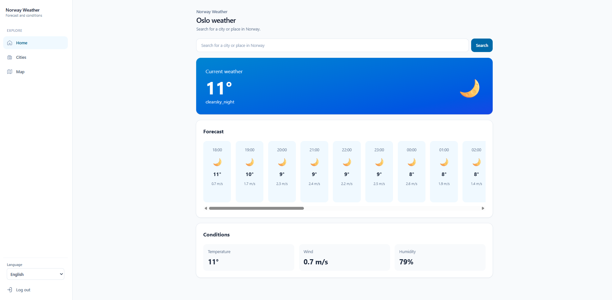
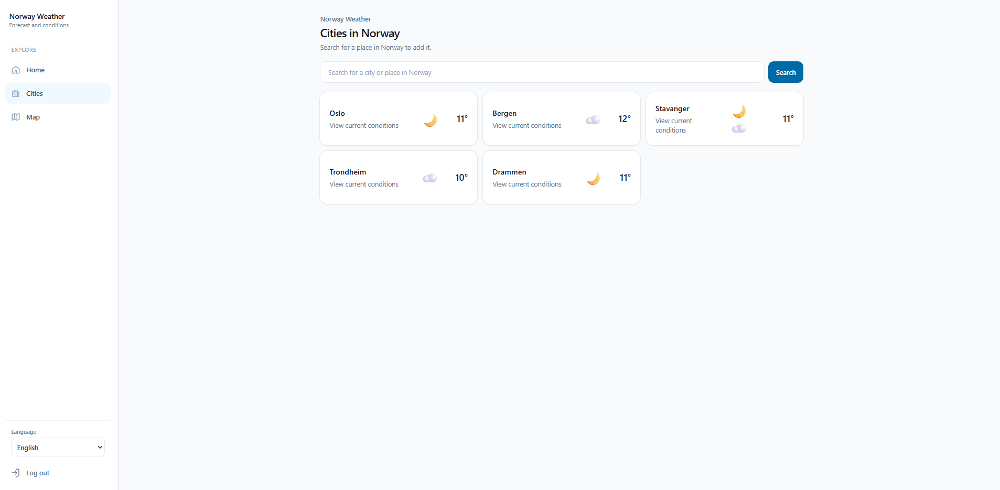
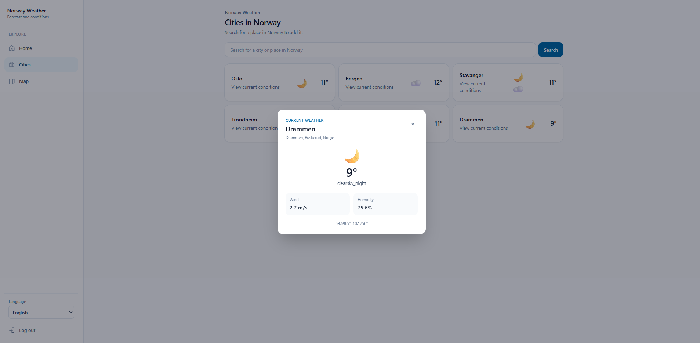
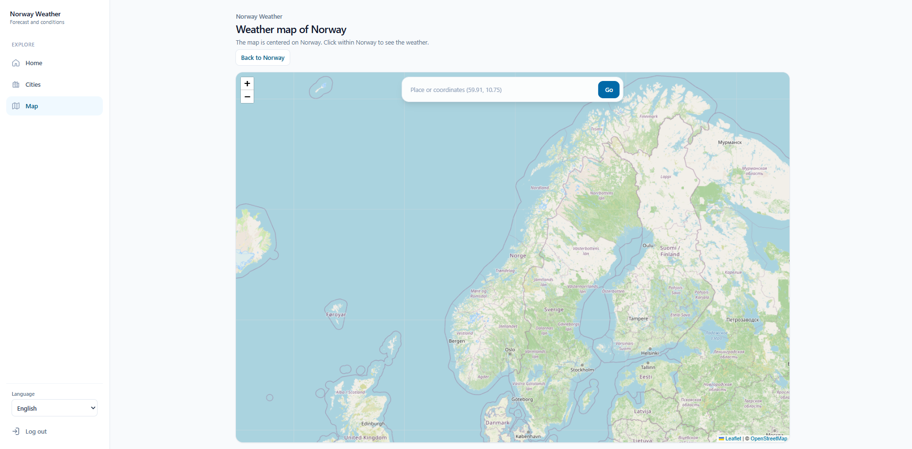
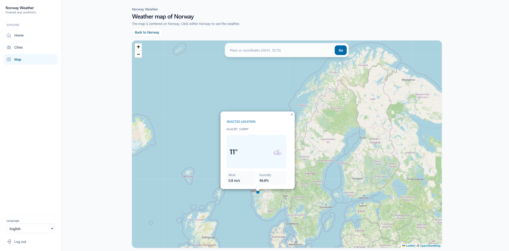
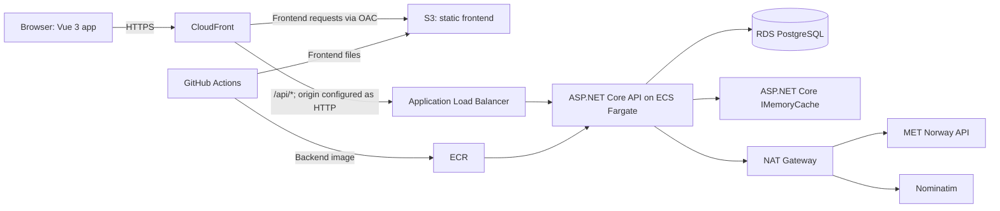

# Norway Weather App

A full-stack weather application for exploring current conditions and short-term forecasts across Norway. The app combines a Vue 3 interface with an ASP.NET Core API, weather data from MET Norway, place search from Nominatim, and Terraform definitions for an AWS deployment architecture.

## Screenshots

### Home

Current conditions, a scrollable forecast, and key weather measurements for the selected location.



### Cities

The cities view shows weather cards for Norwegian cities and supports searching for another place.



Selecting a city opens a detail dialog with additional conditions.



### Interactive map

Search for a place or coordinates, or select a point on the map to load local weather.





## Features

- Current weather and a forecast for the next 24 hours.
- Search for Norwegian places and add locations to the cities view.
- Interactive Leaflet map with place and coordinate search.
- Account registration and sign-in, with authenticated weather endpoints.
- English, Norwegian, and German interface text.
- Server-side in-memory caching of MET Norway forecast responses.

## Architecture



The browser loads the single-page application through CloudFront. CloudFront serves static files from a private S3 origin and routes `/api/*` requests to the ALB. The ALB forwards traffic to the API running in ECS Fargate. The API uses PostgreSQL for ASP.NET Identity data and calls MET Norway and Nominatim through outbound network access. The API also caches forecast responses in process memory.

The Terraform configuration creates the AWS resources shown in the diagram. GitHub Actions workflows define build and deployment steps.

## Technology stack

| Area | Technologies |
|---|---|
| Frontend | Vue 3, JavaScript, Vite, Tailwind CSS 4, Pinia, Vue Router, Axios, Leaflet |
| Backend | C#, ASP.NET Core 10, ASP.NET Core Identity, JWT bearer authentication, `IMemoryCache` |
| Data | PostgreSQL, Entity Framework Core 10, Npgsql migrations |
| Cloud infrastructure | AWS VPC, ECS Fargate, ECR, ALB, RDS, S3, CloudFront, IAM, Secrets Manager, CloudWatch |
| Infrastructure as Code | Terraform, AWS provider |
| CI/CD | GitHub Actions, GitHub OIDC for AWS credentials |
| External services | MET Norway Locationforecast API, Nominatim, OpenStreetMap tiles |

## Frontend

The Vue application is in `norway_weather_ui` and uses the Composition API. Vue Router protects the main application routes; Pinia stores authentication state. A shared Axios client sends cookies with API requests and clears local auth state after an unauthorized response.

The main views are Home, Cities, and Map. Tailwind CSS is integrated through Vite. Leaflet renders the map and OpenStreetMap provides its tile layer. The interface strings are available in English, Norwegian, and German.

## Backend

The API is an ASP.NET Core 10 Web API in `norway_weather_api`. Controllers handle HTTP routes, services encapsulate authentication and external API calls, and DTOs define request and response shapes. `ApplicationDbContext` extends the ASP.NET Core Identity EF Core context.

Weather requests validate latitude and longitude and are restricted to a broad rectangular geographic envelope around Norway. Weather and geocoding calls use typed `HttpClient` registrations. The API exposes Swagger in Development only.

### Weather response cache

`WeatherService` uses ASP.NET Core's `IMemoryCache`, registered with `AddMemoryCache()` in `Program.cs`. Before calling MET Norway, it rounds latitude and longitude to four decimal places and uses those rounded coordinates as the cache key. A successful response's parsed forecast time series is cached for an absolute 25 minutes. Both the current-weather and forecast methods read through this shared lookup: the current endpoint returns the first time-series entry, while the forecast endpoint returns entries in the following 24-hour window.

This is an in-process cache. Each API instance has its own entries, entries are lost when an instance restarts, and separate ECS tasks do not share them. It reduces repeated calls handled by the same running instance; it is not a distributed cache.

## Database

PostgreSQL stores ASP.NET Core Identity users and related identity records. Entity Framework Core manages the schema through migrations in `norway_weather_api/Migrations`. The current application does not define additional weather or saved-city database entities; weather data comes from MET Norway at request time and is cached in memory.

For local development, Docker Compose starts PostgreSQL 17 with a named volume. In the Terraform configuration, RDS is private to the VPC and accepts PostgreSQL traffic from the ECS security group.

## External integrations

- **MET Norway:** `WeatherService` calls the Locationforecast compact endpoint and maps the time series into API response DTOs. The request includes a User-Agent with the configured contact email. Responses are cached in memory for 25 minutes per rounded coordinate pair.
- **Nominatim:** `GeocodingService` searches place names with a Norway country filter and returns up to five results. The API limits query length and includes the configured contact email in the User-Agent.
- **OpenStreetMap:** The map view loads public map tiles from `tile.openstreetmap.org` and displays attribution in the map UI.

External service failures are not wrapped in a common API error format in the current implementation.

## AWS infrastructure

The development Terraform environment defines:

- A VPC with public, private application, and private database subnets across two Availability Zones.
- An Internet Gateway and a NAT Gateway for outbound access from private application subnets.
- Security groups that allow ALB-to-API and API-to-PostgreSQL traffic.
- An internet-facing ALB, ECS Fargate cluster/service, ECR repository, and CloudWatch log group.
- A private S3 bucket with CloudFront Origin Access Control for frontend files.
- A CloudFront distribution that serves the frontend and routes API paths to the ALB.
- An RDS PostgreSQL instance and IAM roles/policies for ECS and GitHub Actions.
- Secrets Manager references for database connection details, JWT signing key, MET Norway contact email, and the allowed frontend origin.

The CloudFront viewer behavior redirects browser traffic to HTTPS. The configured CloudFront-to-ALB origin protocol and ALB listener use HTTP. Review this configuration before describing it as end-to-end encrypted production transport.

## Infrastructure as Code

Terraform is organized into one environment and reusable resource modules:

```text
terraform/
├── environments/
│   └── development/
└── modules/
    ├── alb/
    ├── database/
    ├── ecr/
    ├── ecs/
    ├── frontend/
    ├── iam/
    └── networking/
```

The development environment composes the modules and passes outputs such as subnet IDs, security group IDs, database endpoint, and repository URL between them. Required secret ARNs and environment-specific values must be supplied separately. Terraform state files and secrets should remain out of source control. The repository does not provide a complete bootstrap guide or remote state configuration.

## CI/CD pipeline

`.github/workflows/ci.yml` defines frontend and backend build jobs for pushes and pull requests targeting `main`. `.github/workflows/cd.yml` defines deployment on pushes to `main`:

1. The frontend job installs locked npm dependencies, builds the Vite app, syncs the output to S3, and invalidates CloudFront.
2. The backend job authenticates to AWS using GitHub OIDC, builds an image tagged with the commit SHA, pushes it to ECR, registers a task definition, runs EF Core migrations as an ECS task, then updates the ECS service.

The CI workflow currently uses .NET 8, while the backend targets .NET 10. Aligning these versions would ensure consistent build validation. The repository does not currently include automated test jobs.

The CD workflow automates deployment of the frontend and backend to AWS using GitHub Actions and OIDC authentication. The application has been successfully deployed to AWS, including the ECS backend, RDS PostgreSQL database, database migrations, and frontend hosting through S3 and CloudFront. Deployment requires the corresponding AWS infrastructure, Secrets Manager values, and GitHub repository variables to be configured.

## Security

- ASP.NET Core Identity manages password hashing and user records.
- The API issues a signed JWT in an HttpOnly cookie. The cookie uses `SameSite=Lax`, is scoped to `/api`, and is marked Secure outside Development.
- Weather endpoints require authorization; registration, login, logout, and city search are public.
- CORS is configured for credentialed requests from configured frontend origins.
- Terraform defines a private database, restricted security-group paths, private S3 access through CloudFront OAC, and IAM roles.
- GitHub Actions uses OIDC rather than static AWS access keys. ECS receives application secrets from AWS Secrets Manager.

Do not commit `.env` files, secret values, or Terraform state. For a production setup, review HTTPS between CloudFront and ALB, cookie/CSRF protections, login rate limiting, and least-privilege IAM permissions.

## Project structure

```text
.
├── .github/workflows/       # CI and deployment workflows
├── images/                  # README screenshots
├── norway_weather_api/      # ASP.NET Core API, services, DTOs, migrations
├── norway_weather_ui/       # Vue frontend
├── terraform/               # AWS modules and development environment
├── docker-compose.yml       # Local API, UI, and PostgreSQL services
└── README.md
```

## Getting started

### Requirements

- Docker Desktop with Docker Compose.
- A MET Norway contact email for outbound API identification.

### Run with Docker Compose

1. Copy the root `.env.example` to `.env` and set local PostgreSQL values.
2. Copy `norway_weather_api/.env.example` to `norway_weather_api/.env`. Set `METNO_CONTACT_EMAIL` and a strong base64-encoded `JWT_SECRET_KEY`. Compose supplies `POSTGRES_CONNECTION_STRING` to the API from the root database settings.
3. Start PostgreSQL and wait for its health check:

   ```bash
   docker compose up --build -d postgres
   ```

4. Apply the EF Core migrations using the API's migration mode:

   ```bash
   docker compose run --build --rm -e RUN_MIGRATIONS=true api
   ```

5. Start the application services:

   ```bash
   docker compose up --build
   ```

6. Open the frontend at `http://localhost:3000`. The API is available at `http://localhost:8080`; its Swagger UI is enabled in Development.

The Compose frontend container runs the Vite development server. This is a local development setup, not the production static hosting image.

## Environment variables

Use placeholders in local configuration and never commit actual secrets.

| Variable | Used by | Purpose |
|---|---|---|
| `POSTGRES_DB` | Docker Compose | Local PostgreSQL database name |
| `POSTGRES_USER` | Docker Compose | Local PostgreSQL username |
| `POSTGRES_PASSWORD` | Docker Compose | Local PostgreSQL password |
| `METNO_CONTACT_EMAIL` | API | Contact identity in external API User-Agent headers |
| `JWT_SECRET_KEY` | API | Base64-encoded symmetric key used to sign JWTs |
| `POSTGRES_CONNECTION_STRING` | API | PostgreSQL connection string; Compose builds this for the local database |
| `VITE_API_BASE_URL` | Frontend | API base URL, for example `http://localhost:8080/api` in local development |

The API also reads `Cors:AllowedOrigins` from configuration. Terraform injects the deployed origin through an ECS environment setting sourced from Secrets Manager. AWS deployment workflows use the GitHub repository variables `AWS_ROLE_ARN`, `AWS_REGION`, `FRONTEND_BUCKET`, `CLOUDFRONT_DISTRIBUTION_ID`, and `VITE_API_BASE_URL`; configure these in GitHub rather than adding them to source files.

## API endpoints

All routes are prefixed with `/api`. Weather coordinates are query parameters named `latitude` and `longitude`.

| Method | Route | Access | Description |
|---|---|---|---|
| `POST` | `/auth/register` | Public | Create a user from an email and password |
| `POST` | `/auth/login` | Public | Authenticate and set the JWT cookie; returns `204` on success |
| `POST` | `/auth/logout` | Public | Delete the auth cookie |
| `GET` | `/auth/me` | Authenticated | Return the current user's ID and email |
| `GET` | `/city/search?query=Oslo` | Public | Search for up to five Norwegian places |
| `GET` | `/weather/current?latitude=59.91&longitude=10.75` | Authenticated | Return the current weather entry |
| `GET` | `/weather/forecast?latitude=59.91&longitude=10.75` | Authenticated | Return forecast entries for the next 24 hours |
| `GET` | `/health` | Public | Return a basic process health response |

## Infrastructure deployment

Terraform configuration is under `terraform/environments/development` and `terraform/modules`. The CD workflow assumes the AWS account, OIDC role, ECR/ECS resources, S3 bucket, CloudFront distribution, and required Secrets Manager values already exist or have been provisioned. Review variables, AWS permissions, state handling, and cost implications before applying infrastructure. No apply, destroy, or deployment command is run by this README.

## Potential improvements

These are future improvements, not implemented features:

- Add API rate limiting and login lockout, and review end-to-end TLS, CSRF protection, and authentication security.
- Add a dedicated radar page displaying precipitation and weather radar data.
- Add a profile page where users can manage their account details, preferences, and saved locations.
- Allow users to save favorite cities and customize their weather dashboard.
- Introduce automated backend and frontend tests and integrate them into the CI pipeline.


